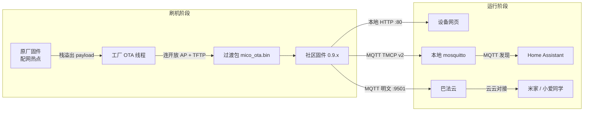

# 斐讯 TC1（A1）免拆刷机与本地接入实录

把这台 2018 年的斐讯 TC1 六位智能排插（硬件版本 A1，模块 EMW3031 / MK3031）从原厂固件迁移到社区固件，然后接入：

- **本地 Home Assistant**（MQTT 自动发现，纯内网）
- **小爱同学**（经巴法云云云对接，可选）

全部流程在 macOS 上实机验证，不需要拆机、焊接、J-Link。

> 本文只记录**我实际跑通并验证过的步骤**，以及每一步的验证方法。原厂固件、社区固件、payload 都属于上游项目，本仓库不含任何固件二进制。

## 目录

| 文档 | 内容 |
|---|---|
| [docs/flash.md](docs/flash.md) | 免拆刷机：原理、macOS 全流程、版本门禁、失败判读 |
| [docs/setup.md](docs/setup.md) | 首次启动、配网、升级到签名稳定版、固定 IP |
| [docs/ha.md](docs/ha.md) | 接入 Home Assistant（本地 MQTT） |
| [docs/xiaoai.md](docs/xiaoai.md) | 接入小爱同学（巴法云） |
| [docs/pitfalls.md](docs/pitfalls.md) | 踩坑清单、排查顺序、安全权衡 |
| [scripts/preflight.sh](scripts/preflight.sh) | 刷机前自检（只读，不改任何配置） |
| [scripts/tc1.sh](scripts/tc1.sh) | 设备 HTTP API 小工具（查状态 / 写配置） |

## 整体链路

关键点：**本地链路（设备网页、HA）和云端链路（巴法云、小爱）互不依赖**。巴法云停服只影响语音，本地控制不受影响。

## 硬件与前置条件

| 项 | 要求 |
|---|---|
| 设备 | 斐讯 TC1 排插，**硬件 A1**，模块 EMW3031 / MK3031（A2 不支持） |
| 原厂版本 | `1.0.0.26` / `1.0.0.24` / `1.0.0.21`，其它版本不要用本仓库的 payload |
| 电脑 | 同时具备**有线**和**无线**网卡的 macOS / Linux / Windows |
| 路由器 | 支持 2.4 GHz、可开**开放（无密码）** SSID、关闭客户端隔离 |

有线网卡可以是 USB 网卡或扩展坞，但有线、无线**必须同时在线**：无线连插排的配网热点发请求，有线连路由器提供 TFTP。

## 上游项目与文件校验

固件、payload、文档全部来自上游社区项目（本仓库只做流程沉淀与验证）：

- 教程与下载：<https://phicomm-io.github.io/guides/tc1-no-disassembly-ethernet-wifi-ap.html>
- 固件源码（GPL-3.0）：<https://github.com/phicomm-io/iotcloud-community-firmware>

用到文件的校验值（已与本仓库流程对照验证）：

| 文件 | 大小 | SHA-256 |
|---|---|---|
| `mico_ota.bin`（过渡包 0.9.6） | 649,344 B | `1c51b4be81cf98451589f3c8c582a76ffec16e8b7aa94cf949bbc127a577035e` |
| `tftp-trigger.bin`（1.0.0.26） | 397 B | `69852f4adeac56080ad9c51744c909e79f411f8b05b574e5fc98865226da16e8` |
| `tftp-trigger-1.0.0.24.bin` | 397 B | `05051691d736aedc52a05aa74ebae36ef759186d99c61b9d45a09f4b7cf53bba` |
| `tftp-trigger-1.0.0.21.bin` | 397 B | `ff2159172ca34c007358623e0621c49091a72a8f71110138f0df89adde5b9c66` |
| `phicomm_tc1_a1.ota.bin.signed`（v0.9.27） | 644,192 B | `a6eb87954f3a1ff3765b6dabda749a26830209eb2be029df4bd9f0461b48072f` |

## 安全结论（简短版）

- **原厂固件本身就不安全**：配网模式下的 `/OTA` 接口无认证且存在栈溢出，同网段任何人进入配网模式后即可刷入任意固件。刷掉原厂应用槽是**修掉**这个洞。
- **payload 不含代码**：`tftp-trigger*.bin` 是 392 字节 `A` + 4 字节返回地址 + NUL，只用来跳转到固件自带的工厂 OTA 函数，可用 `gen-trigger.py` 复算。
- **社区固件**：所有非静态资源路由强制认证，网页密码为空时要求先设置；MQTT 默认关闭；网页 OTA 走 P-256/SHA-256 签名。
- **残余风险**：过渡包是 0.9.6，刷完必须升级签名稳定版；巴法云为公网**明文 TCP**；mosquitto 若保持匿名则局域网内任何设备可读写。

细节见 [docs/pitfalls.md](docs/pitfalls.md)。

## 免责

刷机有变砖风险，失败后恢复需要拆机 + J-Link（本流程不覆盖）。原厂固件、社区固件的许可与第三方组件声明以各自仓库为准。本仓库仅记录个人实践，按 [LICENSE](LICENSE) 提供，不提供任何担保。
